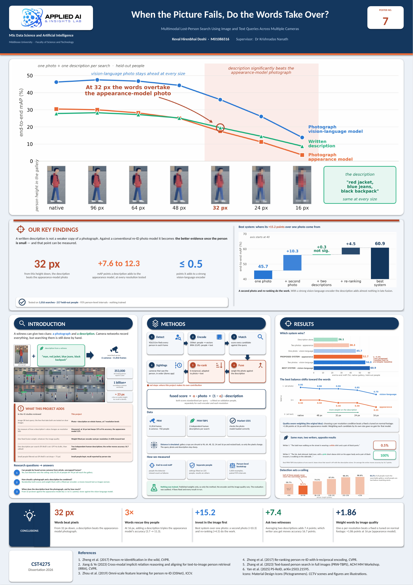
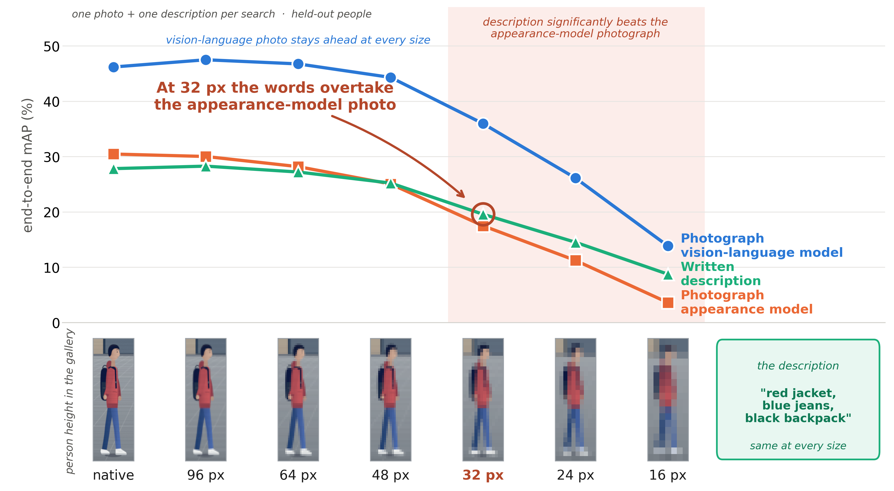
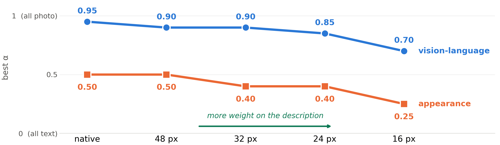
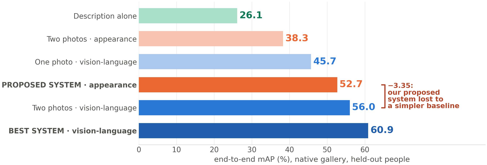
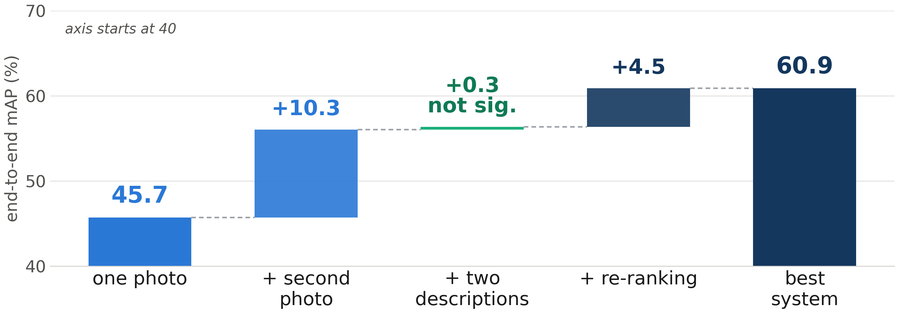

# When the Picture Fails, Do the Words Take Over?

### Multimodal Lost-Person Search Using Image and Text Queries Across Multiple Cameras

**Keval Hirenbhai Doshi** · MSc Data Science and Artificial Intelligence · Middlesex University (CST4275, 2026)
Supervisor: Dr Krishnadas Nanath

When someone goes missing, the family can almost always give two clues: **a photograph** and **a description of what the person was wearing**. This project builds a system that searches recorded footage from several CCTV cameras using a photograph, a written description, or both, and measures **when the description is worth more than the photograph** as people become small and blurry in the footage.



> Full A1 poster: [`docs/poster/Poster_A1.pdf`](docs/poster/Poster_A1.pdf)

---

## Contents

1. [Key findings](#1-key-findings)
2. [Research questions and answers](#2-research-questions-and-answers)
3. [How the system works](#3-how-the-system-works)
4. [Data](#4-data)
5. [How it was evaluated](#5-how-it-was-evaluated)
6. [Results](#6-results)
7. [Repository structure](#7-repository-structure)
8. [Setup](#8-setup)
9. [Reproducing the results](#9-reproducing-the-results)
10. [Running the demo app](#10-running-the-demo-app)
11. [Verifying the reported numbers](#11-verifying-the-reported-numbers)
12. [Limitations](#12-limitations)
13. [Ethics](#13-ethics)
14. [References](#14-references)
15. [Author, acknowledgements and licence](#15-author-acknowledgements-and-licence)

---

## 1. Key findings

| | Finding |
|---|---|
| **32 px** | **Words beat pixels.** From 32 pixels of person height down, a written description is *significantly* better than a photograph encoded with a conventional appearance (re-ID) model. |
| **3×** | **Words rescue tiny people.** At 16 px, adding a description triples the appearance model's accuracy (3.7 → 11.3 mAP). |
| **+15.2** | **Invest in the image first.** The best system reaches 60.9 end-to-end mAP, +15.2 points over one photograph; the gain comes from a second photograph (+10.3) and re-ranking (+4.5), not from the description. |
| **+7.4** | **Ask two witnesses.** Averaging two independently written descriptions adds 7.4 points; which writer you get moves accuracy by 16.7 points on average. |
| **+1.86** | **Weight words by image quality.** Choosing the photo/text balance per resolution condition beats a fixed balance tuned on normal footage by +1.86 points at 16 px (appearance model). |

**The main conclusion:** a description is not a weaker copy of a photograph. It compensates for lost resolution *as much as the photo model breaks down*: it adds **+7.6 to +12.3** mAP points to a conventional appearance model at every resolution tested, but **≤ 0.5** points to a strong vision-language encoder. For both encoders, the best weighting moves toward the description as images get worse.

All results: **1,016 searches from 217 held-out people**, end-to-end mAP, 95% person-level bootstrap intervals, **no model trained**.

---

## 2. Research questions and answers

| # | Question | Answer |
|---|---|---|
| **RQ1** | Can people be detected and re-identified across several cameras when only whole, uncropped frames are available? | **Yes, but detection sets the ceiling.** 86.2% of people reach the searchable gallery, but only 50.2% of people 64–96 px tall. The best system reaches 60.9 end-to-end mAP. |
| **RQ2** | How should a written description be combined with a photograph? | Standardise both scores per query and weight them with **α fitted per encoder** (and per resolution). The description adds +7.6 to +12.3 points with the appearance model and ≤ 0.5 with the vision-language model. |
| **RQ3** | How does lower resolution affect appearance matching, and how far can a description make up for it? | Against the appearance model the description is significantly better **from 32 px down** (by 2.1 to 5.1 points). At 16 px the description keeps **31.4%** of its accuracy, the appearance model **11.8%**. The vision-language photo stays ahead at every size. |

---

## 3. How the system works



```
                     ┌────────────── done once, cached to disk ──────────────┐
 11,816 CCTV frames → ① DETECT → person crops → ② ENCODE → 512-d vectors
                     └────────────────────────────────────────────────────────┘
 photo  ─┐
         ├→ ② ENCODE query → ③ MATCH → ④ FUSE → ⑤ RE-RANK → ⑥ SIGHTINGS → human review
 text   ─┘
```

| Step | What happens |
|---|---|
| **① Detect** | **YOLO11m** finds every person in each full frame (confidence 0.25 saved, 0.5 used for the gallery: 66,557 → 50,254 crops). Detections that match no annotated person are **kept as distractors**. Slicing-aided (tiled) inference was implemented and evaluated, and not adopted on this dataset. |
| **② Encode** | Every crop and query becomes a 512-d vector: **OSNet** (appearance model, MSMT17 weights) and **IRRA** (CLIP ViT-B/16 fine-tuned for text-to-person retrieval), which encodes both images *and* descriptions in one shared space. Two photographs or two descriptions are averaged into one query. |
| **③ Match** | Cosine similarity between the query and every gallery crop gives a photo score list and a description score list. |
| **④ Fuse** | Both score lists are standardised (z-score) per query, then combined: **fused = α · photo + (1 − α) · description**, with α fitted on validation identities. |
| **⑤ Re-rank** | k-reciprocal re-ranking (k1 = 20, k2 = 6, λ = 0.3) of the top 200, adapted to photo + text: neighbourhoods come from image features, the ranking refined is the fused score, and the tail keeps its original order. |
| **⑥ Sightings** | Results are grouped by camera; candidates within 25 frames in the same camera and segment are merged. The output is a **shortlist for human review**, not an identification. |

**Simulating distance.** PRW contains few small people (median height 163 px; 6.8% below 96 px), so distance is simulated: gallery crops are shrunk to **96, 64, 48, 32, 24 and 16 px** and resized back, so only the pixels change. The query photo and the description stay at full quality, as in a real search. Two galleries are reported: **native** and **mixed** (each crop randomly assigned one of the seven levels, fixed seed).

---

## 4. Data

| Dataset | Role | Contents |
|---|---|---|
| **PRW** | Main benchmark | 11,816 whole frames, 6 cameras, 932 identities, 2,057 query boxes |
| **PRW-TBPS** | Descriptions | **Two independent human-written descriptions** per test query, 450 test identities |
| **Market-1501** | Instrument check only | Used once to confirm the appearance model loaded correctly (66.2% Rank-1 / 39.8% mAP) |

**No dataset images are included in this repository.** Download links for all datasets and pretrained models are in **[`DATASET_LINKS.md`](DATASET_LINKS.md)**.

Why OSNet trained on MSMT17 and not Market-1501: Market-1501 was recorded on the same campus with the same cameras as PRW, so a Market-trained backbone would be close to its own training domain.

---

## 5. How it was evaluated

- **Frozen models.** Nothing was trained or fine-tuned. Only three things vary: the method, the image encoder and the image quality.
- **Separate people.** The 450 test identities are split by identity (fixed seed): 225 for fitting settings (validation), 225 for reporting (held-out), giving 1,016 scorable searches from 217 people.
- **End-to-end mAP** (primary): appearances the detector missed count as failures. Conditional mAP and Rank-1 are also reported.
- **Exclusion rule:** only the query person's appearances on the query camera(s) are removed; other people on that camera stay as distractors.
- **Person-level paired bootstrap:** 5,000 resamples of *people* (not searches), seed 0, 95% percentile intervals. An interval that crosses zero is reported as *no significant difference detected*, never as "equal".
- **Components measured by removal** from the complete system.
- **Audited evaluation.** An audit of the evaluation code found four problems (camera exclusion too broad, missed detections not counted, intervals resampling searches, arbitrary order below the re-ranked top 200). All four were fixed and every result regenerated.

---

## 6. Results

### Single source, native gallery (end-to-end mAP)

| Query | End-to-end mAP [95% CI] | Rank-1 |
|---|---|---|
| Description only | 26.11 [23.18, 29.00] | 37.6% |
| One photo, appearance model (OSNet) | 29.04 [26.19, 31.96] | 53.0% |
| One photo, vision-language model (IRRA) | 45.71 [42.37, 49.03] | 65.1% |
| Two descriptions, averaged | 33.51 [30.32, 36.70] | 48.0% |
| Two photos, OSNet | 38.29 [34.98, 41.64] | 66.7% |
| Two photos, IRRA | 56.02 [52.53, 59.46] | 78.2% |

### Resolution study (one photo + one description per search)

| Gallery height | OSNet photo | IRRA photo | Description | OSNet − description |
|---|---|---|---|---|
| native | 30.45 | 46.18 | 27.81 | +2.64 [+0.19, +4.99] |
| 96 px | 30.01 | 47.49 | 28.26 | +1.74 (n.s.) |
| 64 px | 28.17 | 46.74 | 27.20 | +0.97 (n.s.) |
| 48 px | 25.03 | 44.30 | 25.20 | −0.17 (n.s.) |
| **32 px** | 17.48 | 35.94 | 19.57 | **−2.09 [−4.04, −0.14]** |
| 24 px | 11.23 | 26.11 | 14.51 | −3.28 [−4.91, −1.67] |
| 16 px | 3.60 | 13.84 | 8.74 | −5.13 [−6.50, −3.91] |

### Adding the description (two photos + two descriptions, α tuned on validation)

| Gallery | OSNet: photos → + description | Gain | IRRA: photos → + description | Gain |
|---|---|---|---|---|
| native | 38.29 → 48.81 | **+10.52** | 56.02 → 56.32 | +0.30 |
| mixed | 25.36 → 33.99 | **+8.63** | 39.30 → 39.59 | +0.29 |
| 32 px | 21.46 → 33.38 | **+11.92** | 41.24 → 41.66 | +0.42 |
| 16 px | 3.73 → 11.29 | **+7.56 (×3)** | 15.24 → 15.73 | +0.49 |

The best α moves toward the description as resolution falls: **0.50 → 0.25** (OSNet) and **0.95 → 0.70** (IRRA).



### Complete systems (end-to-end mAP)

| Method | Native | Mixed |
|---|---|---|
| Two photos, IRRA | 56.02 | 39.30 |
| Complete system, OSNet | 52.68 | 37.23 |
| **Complete system, IRRA (best)** | **60.88** | **42.84** |



The best system gains **+15.17** over one photograph. Its gain comes from the **second photograph (+10.31)** and **re-ranking (+4.51)**; the description adds +0.02 (n.s.) at the shared balance and +0.31 at a re-tuned balance (61.17), and the two configurations do not differ significantly (+0.29 [−0.16, +0.76]). The OSNet system is significantly worse than two IRRA photographs alone (−3.35).



### Component analysis (OSNet system, change in end-to-end mAP)

| Change | Native | Mixed |
|---|---|---|
| Remove fusion (description) | −9.25 | −8.72 |
| Remove second photograph | −6.00 | −4.11 |
| Remove re-ranking | −3.96 | −3.26 |
| Remove second description | −3.75 | −2.86 |
| Add query expansion | −0.46 | −0.50 |
| Add resolution matching | +0.06 (n.s.) | +0.91 |

### Other results (exploratory)

- **Two writers:** which description is used moves description-only mAP by **16.7 points** on average; averaging both adds **+7.4**.
- **Quality-aware weighting:** α per resolution condition beats a fixed α by **+1.86** at 16 px (OSNet); per-candidate weighting gave no gain for OSNet.
- **Complementarity:** the OSNet photo and the description retrieve largely different correct people (overlap 0.237).
- **Confidence signal:** the top fused score separates searches whose first result is correct 20% of the time from those correct 83% of the time.
- **Failures:** the best system's first result is wrong in 22.7% of searches; people with few appearances are hardest (Rank-1 46.0% vs 87.2%).

All figures from the dissertation are in [`figures/`](figures/); all raw outputs are in [`results/`](results/).

---

## 7. Repository structure

```
multimodal-lost-person-search/
├── README.md               this file
├── DATASET_LINKS.md        download links for every dataset and pretrained model
├── requirements.txt        Python packages
├── verify_tables.py        checks reported numbers against results/
├── code/                   26 Python scripts (full pipeline + evaluation)
├── results/                evaluation outputs (CSV / TXT / JSON) and config.json
├── figures/                result figures
└── docs/
    ├── PROJECT_DETAILS.md  long-form technical write-up
    ├── poster/             A1 poster (PDF + preview)
    └── images/             images used in this README
```

**Scripts by role**

| Group | Scripts | Purpose |
|---|---|---|
| Build (run once, GPU) | `verify.py`, `phase2_detect.py`, `phase2_eval.py`, `phase2_tiling_ablation.py`, `phase3_sanity.py`, `phase3_irra.py`, `phase3_encode.py`, `phase4_resolution.py`, `phase7_resmatch.py` | Check data, detect people, load and validate models, encode the gallery, build degraded copies |
| **Final evaluation** | `step1_corrected_eval.py`, `step1b_alpha.py`, `step1c_condition_alpha.py`, `step1d_remaining.py`, `step1e_confidence.py` | Produce every reported result under the corrected protocol |
| Output and demo | `phase6_timeline.py`, `phase6_app.py` | Sightings per camera; Gradio search interface |
| Exploratory / earlier | `phase3_baseline.py`, `phase4_analysis.py`, `phase5_fusion.py`, `phase6_analysis.py`, `phase6_deep.py`, `phase8_debug.py` | Development analyses |
| Superseded (pre-correction protocol) | `phase4_map_ci.py`, `phase5_ci.py`, `phase7_algorithms.py`, `phase8_full.py` | Kept for traceability; **not** used for any reported result |

---

## 8. Setup

Tested on Windows with Python 3.11 and an NVIDIA RTX 4060 (8 GB). The final evaluation and the demo also run on CPU.

**1. Clone and create a virtual environment**

```powershell
git clone https://github.com/keval-doshi/multimodal-lost-person-search.git
cd multimodal-lost-person-search
python -m venv .venv
.venv\Scripts\Activate.ps1
```

**2. Install PyTorch with CUDA** (choose the command for your CUDA version at <https://pytorch.org/get-started/locally/>), then the rest:

```powershell
pip install -r requirements.txt
python -c "import torch; print(torch.cuda.is_available())"   # should print True
```

**3. Get the datasets, models and IRRA code** (links in [`DATASET_LINKS.md`](DATASET_LINKS.md)) and arrange them like this:

```
multimodal-lost-person-search/
├── code/
├── dataset/
│   ├── PRW/            frames/  annotations/  query_box/
│   ├── PRW-TBPS/       PRW-TBPS_train  PRW-TBPS_test
│   └── Market-1501/    bounding_box_train/  bounding_box_test/  query/
├── models/
│   ├── osnet_x1_0_msmt17.pth      (phase3_sanity.py downloads it)
│   └── irra/best.pth              (IRRA checkpoint)
└── IRRA/                          git clone https://github.com/anosorae/IRRA
```

`dataset/`, `models/`, `cache/` and `IRRA/` are ignored by git.

---

## 9. Reproducing the results

Run from the repository root. **Build the caches** (expensive stages, run once):

```powershell
python code\verify.py              --root .\dataset
python code\phase2_detect.py       --root .\dataset --mode full
python code\phase2_eval.py         --root .\dataset --split test
python code\phase3_sanity.py       --root .\dataset
python code\phase3_encode.py       --root .\dataset
python code\phase4_resolution.py   --root .\dataset
python code\phase7_resmatch.py     --root .\dataset --encode
```

**Regenerate every reported result** from the caches (no GPU needed):

```powershell
python code\step1_corrected_eval.py    --root .\dataset
python code\step1b_alpha.py            --root .\dataset
python code\step1c_condition_alpha.py  --root .\dataset
python code\step1d_remaining.py        --root .\dataset
python code\step1e_confidence.py       --root .\dataset
```

Every script accepts `--limit N` for a quick smoke test. Settings are recorded in [`results/config.json`](results/config.json): α = 0.45 (OSNet) and 0.80 (IRRA) for the system comparison; k1 = 20, k2 = 6, λ = 0.3 over the top 200; 5,000 identity-level resamples; seed 0.

| Stage | Runtime (RTX 4060) |
|---|---|
| Detection, 11,816 frames | 17 min |
| Encoding, 50,254 crops | 16 min |
| Degradation, 7 levels | 50 min |
| Retrieval experiments | seconds each |

---

## 10. Running the demo app

```powershell
python code\phase6_app.py --root .\dataset --repo .\IRRA --ckpt .\models\irra\best.pth
```

Open <http://127.0.0.1:7860>. Upload a photograph (for example from `dataset\PRW\query_box\`), type a clothing description, or both, and the app shows candidate sightings grouped by camera. A slider sets the balance α.

The interface runs the single-photograph configuration (OSNet, one photo + one description, α = 0.45); the complete system is implemented in the evaluation scripts.

---

## 11. Verifying the reported numbers

`verify_tables.py` reads the numbers from the dissertation's tables and checks each one against the files in `results/`, recomputing bootstrap intervals with the project's own `cboot()` (seed 0, 5,000 identity-level resamples).

```powershell
pip install python-docx pandas numpy
python verify_tables.py path\to\Dissertation.docx
```

Result: **226 checks pass, 0 fail.** The dissertation file itself is not included in this repository. The confidence-band table is checked when `results/e_confidence.txt` and `results/e_confidence_perquery.csv` (written by `step1e_confidence.py`) are present.

---

## 12. Limitations

- **Distance is simulated.** Shrinking crops removes pixels but not motion blur, compression or sensor noise.
- **One benchmark, one campus.** Findings were checked on two encoders, not two camera networks.
- **IRRA was fine-tuned on CUHK-PEDES**, which includes Market-1501 imagery from the same campus as PRW, which may favour IRRA.
- **No usable timestamps** in PRW, so sightings are ordered within a camera segment, not across cameras.
- The evaluation protocol keeps distractors and differs from the official PRW protocol, so numbers are **not directly comparable** with published PRW results.
- Re-ranking uses the top 200 candidates; the full method may behave differently.
- The confidence-signal, complementarity, writer and failure analyses are **exploratory**.
- The demo app implements the single-photograph configuration only.

---

## 13. Ethics

- Only **public research datasets** are used; no live cameras, no private footage and no human participants. The project's ethics screening was approved before work began.
- There is **no face-recognition component**. Faces at these distances are about 23 px (eyes about 7 px apart). The crops do include the head, and whole-body appearance features can themselves be personal data, so this reduces rather than removes the privacy risk.
- A tool that can find a missing person can also follow anyone. **The difference is authorisation, not capability.** Any deployment would need a lawful basis, authorisation for each search, human review of every result, limited retention and an audit trail.
- The first result is wrong in roughly a quarter of searches, so the output must be treated as a **shortlist for human review, never an identification**.

---

## 14. References

1. Zheng, L. et al. (2017) *Person re-identification in the wild.* CVPR.
2. Zhang, S. et al. (2023) *Text-based person search in full images via semantic-driven proposal generation* (PRW-TBPS). ACM MM Workshop.
3. Zheng, L. et al. (2015) *Scalable person re-identification: a benchmark* (Market-1501). ICCV.
4. Zhou, K. et al. (2019) *Omni-scale feature learning for person re-identification* (OSNet). ICCV.
5. Jiang, D. and Ye, M. (2023) *Cross-modal implicit relation reasoning and aligning for text-to-image person retrieval* (IRRA). CVPR.
6. Radford, A. et al. (2021) *Learning transferable visual models from natural language supervision* (CLIP). ICML.
7. Zhong, Z. et al. (2017) *Re-ranking person re-identification with k-reciprocal encoding.* CVPR.
8. Akyon, F. C., Altinuc, S. O. and Temizel, A. (2022) *Slicing aided hyper inference and fine-tuning for small object detection* (SAHI). ICIP.
9. Yan, S. et al. (2025) *PS-ReID.* arXiv:2503.21595.
10. Ultralytics YOLO11: <https://docs.ultralytics.com/models/yolo11/>

---

## 15. Author, acknowledgements and licence

**Keval Hirenbhai Doshi**, MSc Data Science and Artificial Intelligence, Middlesex University.
Thanks to my supervisor, **Dr Krishnadas Nanath**, and to the authors of PRW, PRW-TBPS, Market-1501, OSNet, IRRA and YOLO for releasing their data and models.

The code in this repository is released under the MIT Licence (see [`LICENSE`](LICENSE)). The datasets and pretrained models are **not** included and remain under their own terms. Download them from the official sources in [`DATASET_LINKS.md`](DATASET_LINKS.md) and cite the original papers.
